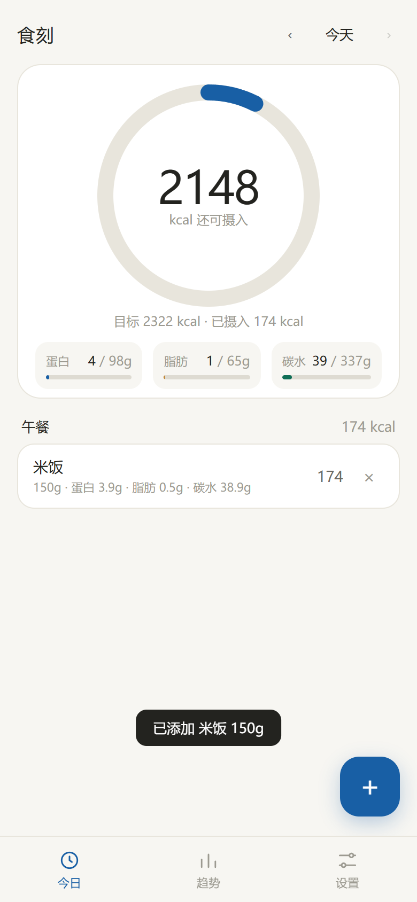
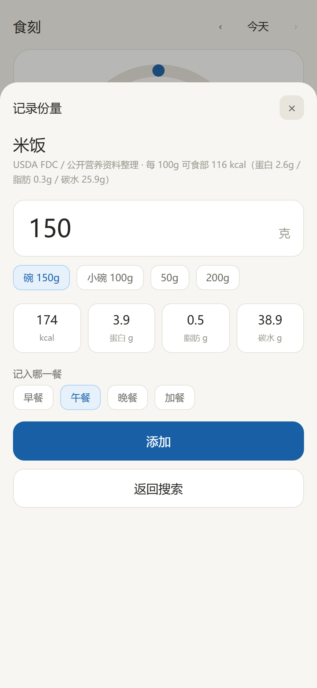
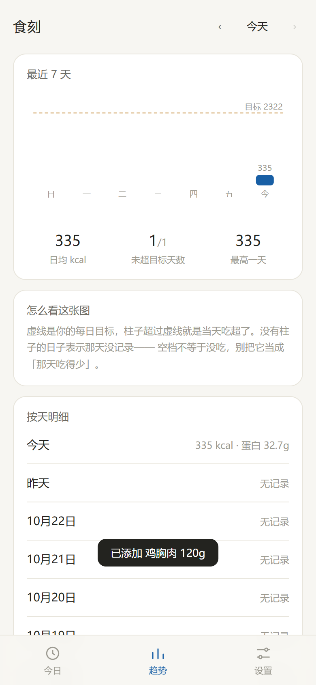

# 食刻 · shike

离线优先的食物热量记录器。打开就是「今天还能吃多少」，记完自动算三大营养素，数据只存在你自己的设备上。

PWA 形态，一套代码跑在手机浏览器和桌面，可添加到主屏幕当原生 App 用。



<p>
  
  
</p>

## 它做什么

- **今日进度环**：剩余热量一眼可见，超出目标时环变红并显示超出量
- **份量换算**：支持克数与「一碗 / 一个 / 一片」等家常份量，两套口径随时切换
- **三大营养素**：蛋白 / 脂肪 / 碳水 分别对照目标，进度条实时更新
- **按餐次记录**：早 / 午 / 晚 / 加餐，每餐小计
- **目标管理**：Mifflin-St Jeor 算基础代谢，按活动量与减脂/增肌目标推算每日热量与配比
- **7 日趋势**：柱状图对照目标线，含日均、未超目标天数
- **自定义食物**：家常菜没有标准数据，按自己的配方建一条
- **导出 / 导入备份**：JSON 全量备份，换设备或浏览器清数据后可恢复
- **完全离线**：Service Worker 预缓存，断网可用，代码里没有一处网络请求

## 技术栈

React 19 + TypeScript + Vite 8，本地存储 Dexie（IndexedDB），PWA 用 vite-plugin-pwa。
**零运行时依赖之外的东西**：没有 UI 库、没有图表库、没有状态管理库——环形进度和柱状图都是手写 SVG。

生产包 **115 KB（gzip）**，首屏无需二次请求。

## 快速开始

```bash
npm install
npm run dev      # http://localhost:5173
npm test         # 36 项单元测试
npm run build    # 产物在 dist/
npm run preview  # 预览生产构建
```

## 项目结构

```
shike/
├── src/
│   ├── core/              纯函数，零依赖，可跨端复用
│   │   ├── nutrition.ts   BMR / TDEE / 目标 / 宏量分配
│   │   ├── day.ts         逻辑日（凌晨算前一天）
│   │   ├── units.ts       份量换算、求和、检索
│   │   └── types.ts       领域类型
│   ├── data/foods.ts      179 条食物库
│   ├── storage/
│   │   ├── db.ts          Dexie schema
│   │   └── repo.ts        业务动作（目标分版本、记录 CRUD、备份）
│   ├── features/          今日 / 添加 / 趋势 / 设置
│   ├── ui/Ring.tsx        手写 SVG 进度环
│   └── App.tsx
├── tests/                 36 项测试，含食物库自洽性校验
└── scripts/               图标生成、开发期截图
```

`core/` 不 import 任何浏览器 API，所以换到小程序或原生时只需重写 `storage/`。


## 部署

构建产物是纯静态文件，`base` 已设为相对路径，可直接部署到任何静态托管：

```bash
npm run build
# 把 dist/ 上传即可
```

Service Worker 需要 HTTPS（`localhost` 例外），上述平台默认提供。

## 边界与免责

- 食物数据取常见品种均值，同种食物因产地、部位、烹饪方式不同会有 **±20% 波动**；一餐的估算误差轻松到 ±25%。这里给的是区间感，不是仪器读数。
- 不提供医疗建议，不做疾病干预。**孕期、慢性病（肾病限钾限磷、糖尿病、痛风）、进食障碍人群请遵医嘱**，本工具不适用。
#
## Roadmap

- [ ] 常吃食物在今日页一键复现
- [ ] 体重记录与趋势叠加
- [ ] 周/月报告（环比、达标率）
- [ ] 条码扫描（需原生壳，Web 端 iOS 不支持 `BarcodeDetector`）

## License

MIT
